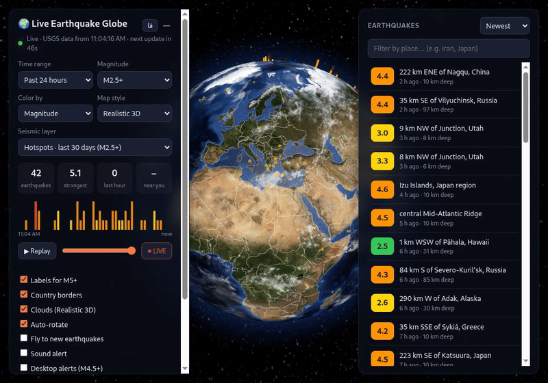
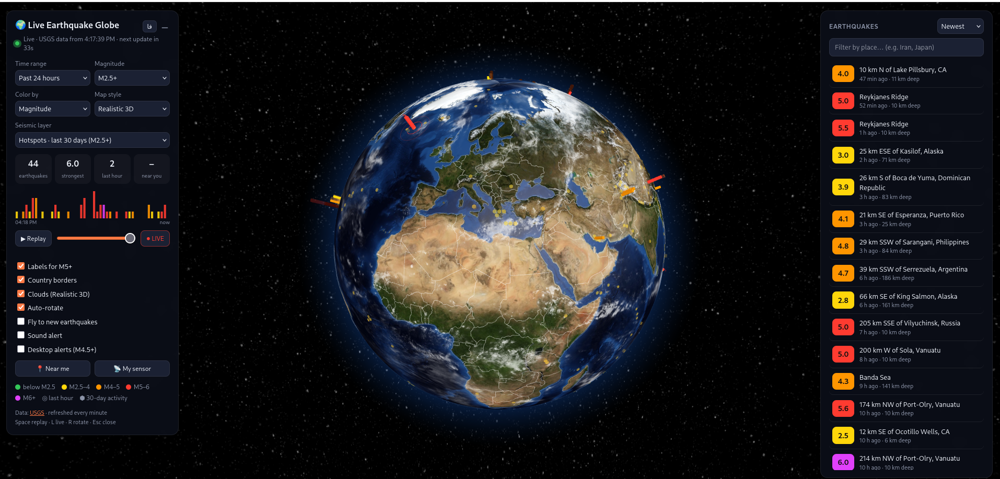
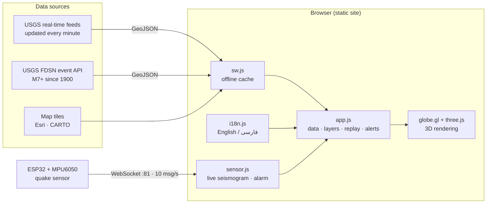
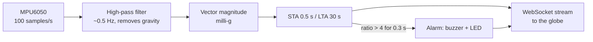

# 🌍 Live Earthquake Globe



[](https://ali30mhi.github.io/earthquake-globe/)
[](LICENSE)
[](https://earthquake.usgs.gov/)




A real-time 3D globe of earthquakes worldwide — plus a DIY seismic sensor that streams live shaking data to it.
All earthquake data comes from the **U.S. Geological Survey (USGS)**. English & فارسی.

**Live demo:** https://Ali30mhi.github.io/earthquake-globe/

## Features

- **Live data** – refreshes every 60 s from the official USGS real-time feeds
- **History since 1900** – every M7+ earthquake from the USGS FDSN event service, binned on the globe
- **Shaking where you are** – estimated intensity (Modified Mercalli) of each quake at your location
- **Four map styles** – Realistic 3D (relief, shiny oceans, clouds), Satellite HD & Dark map HD (sharper as you zoom), Night lights
- **Timeline replay**, activity chart, magnitude labels, color by magnitude or depth, country borders
- **Alerts** – on-screen, sound, desktop notifications (M4.5+), tab-title counter, auto-fly
- **English / فارسی** with full right-to-left layout and the Persian calendar
- **Installable PWA, works offline** – shows the last saved data during internet outages
- **DIY sensor** – ESP32 + MPU6050 detects local shaking, sounds a buzzer and streams a live seismogram ([sensor/README.md](sensor/README.md))
- No build step, no backend, no API key

## Architecture



### Sensor detection pipeline



| File | Role |
| --- | --- |
| `index.html` | Layout and controls |
| `style.css` | UI styling, right-to-left support |
| `i18n.js` | Translations, localized numbers and dates |
| `app.js` | Fetches USGS data, globe layers, replay, alerts, intensity estimate |
| `sensor.js` | WebSocket client for the ESP32 sensor |
| `sw.js` | Service worker: network-first for data, cache-first for map tiles |
| `sensor/quake_sensor/` | ESP32 firmware (STA/LTA trigger) |

## Run locally

```bash
git clone https://github.com/Ali30mhi/earthquake-globe.git
cd earthquake-globe
python3 -m http.server 8000
# open http://localhost:8000
```

## Deploy on GitHub Pages

**Settings → Pages → Deploy from a branch → `main` / `(root)` → Save**.
The sensor panel only works on a local (http) copy, because browsers block `ws://` connections from https pages.

## Data sources & credits

- Earthquakes: [USGS real-time feeds](https://earthquake.usgs.gov/earthquakes/feed/v1.0/geojson.php) and [FDSN event service](https://earthquake.usgs.gov/fdsnws/event/1/)
- Intensity estimate: Bakun & Wentworth (1997); sensor intensity: Wald et al. (1999)
- 3D: [globe.gl](https://github.com/vasturiano/globe.gl) (MIT), [three.js](https://threejs.org/); textures: three-globe examples, clouds from webgl-earth
- Satellite imagery © Esri, Maxar, Earthstar Geographics · Dark map © OpenStreetMap contributors © CARTO
- Country borders: Natural Earth · Persian font: Vazirmatn

## Roadmap

- [x] Live USGS data, timeline replay, alerts
- [x] Major earthquakes since 1900, intensity estimate at your location
- [x] English / فارسی, installable offline PWA
- [x] DIY ESP32 sensor with live seismogram
- [ ] Optional second data source for small regional quakes (e.g. IRSC for Iran)
- [ ] Combine several sensors into a small network to reduce false alarms
- [ ] Low-noise ADXL355 sensor version

## Disclaimer

A visualization and learning project — **not an official warning system**. Estimated intensities are rough.
For official alerts, follow your national seismological agency.

## فارسی

یک کره‌ی سه‌بعدی که زلزله‌های سراسر جهان را به‌صورت زنده و با داده‌های رسمی سازمان زمین‌شناسی آمریکا (USGS) نشان می‌دهد: نمایش زنده و بازپخش زمانی، زلزله‌های بزرگ از سال ۱۹۰۰، تخمین شدت لرزش در محل شما، رابط کاربری کامل فارسی، کار در حالت آفلاین، و یک حسگر لرزه‌ی ساده با ESP32 که داده‌ی زنده را روی سایت نمایش می‌دهد.

**نسخه‌ی زنده:** https://ali30mhi.github.io/earthquake-globe/

## License

MIT
